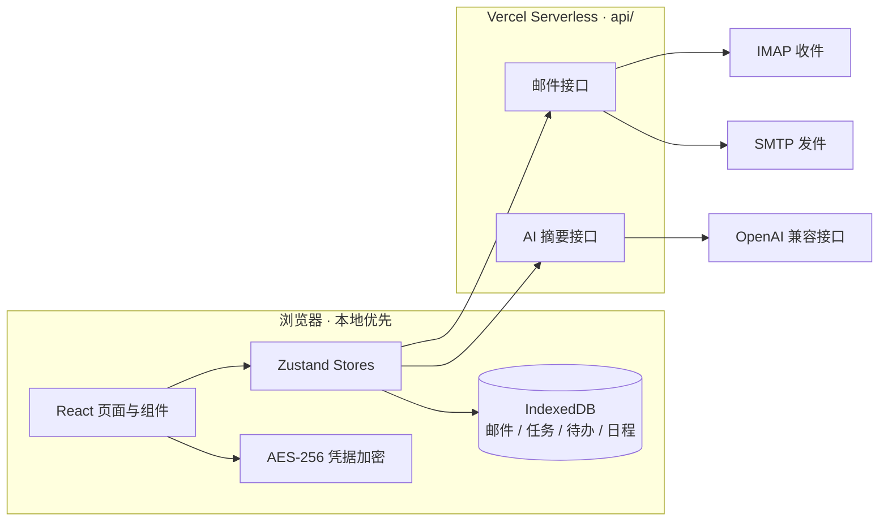

<div align="center">

# 📬 MailTools

**把收件箱变成可执行的工作台。**

AI 邮件摘要 · 任务自动归档 · 待办清单 · 日历提醒

[](https://react.dev/)
[](https://www.typescriptlang.org/)
[](https://vitejs.dev/)
[](https://tailwindcss.com/)
[](https://vitest.dev/)
[](#-贡献)

[功能](#-功能) · [快速开始](#-快速开始) · [配置](#-配置) · [架构](#-架构) · [部署](#-部署到-vercel) · [隐私](#-隐私与安全)

</div>

---

## 📖 这是什么

**MailTools** 是一个本地优先的智能邮件助手，面向每天被大量邮件淹没、又需要从邮件里持续跟进任务的人。

它把「读邮件」到「做事情」之间的几步连了起来：自动同步 IMAP 邮箱，用 AI 提炼每封邮件的核心内容、关键要点和行动项，再把同一件事的往来邮件归档成任务，把行动项变成待办，把会议和截止时间放进日历。

和常见邮件客户端相比，MailTools 的重点不是「收发更多邮件」，而是：

- **少读**：一眼看清一封邮件要你做什么
- **不漏**：行动项、截止时间、会议自动进入待办和日历
- **不断线**：同一任务的上下文按时间线聚合
- **留在本地**：邮件与任务数据存浏览器 IndexedDB，不上传业务数据

> 项目默认的 IMAP/SMTP 主机使用 `example.com` 占位，首次使用请在「设置」页填写你自己的邮箱服务商参数。

## ✨ 功能

| 模块 | 能力 |
| --- | --- |
| 📥 **收件箱** | IMAP 定时同步、增量拉取、分类胶囊、未读筛选、主题/发件人搜索、虚拟滚动 |
| 🤖 **AI 摘要** | 核心内容、关键要点、行动项、情感倾向；支持流式输出与本地降级 |
| 🗂️ **任务归档** | 按引用链、主题相似度、项目代号自动把邮件归入任务，保留完整时间线 |
| ✅ **待办清单** | 从邮件提取行动项，支持完成状态、截止时间、来源邮件跳转 |
| 📅 **日历提醒** | 月/周/日视图，邮件与待办一键入历，浏览器通知提醒 |
| ✍️ **写信** | SMTP 发送、附件、富文本、回复/转发、草稿与已发送 |
| 👥 **联系人** | 从往来邮件自动沉淀地址簿，写信时自动补全 |
| 🎨 **个性化** | 深色模式、字号缩放、同步间隔、自动同步开关 |
| 🧪 **演示数据** | 设置页一键载入内置示例数据，无需邮箱也能体验完整流程 |

## 🧭 典型使用流程

1. **配置邮箱**：在「设置」页填写 IMAP/SMTP 主机、端口与账号，先点「测试连接」。
2. **同步邮件**：应用打开时自动同步，也可按 5/15/30 分钟间隔定时同步。
3. **生成摘要**：配置 OpenAI 兼容接口后，邮件会自动排队生成摘要；失败时降级为本地摘要。
4. **处理任务**：进入「任务」查看同一事项的邮件时间线；进入「待办」勾选完成。
5. **安排时间**：把待办或会议邮件加入日历，到点通过浏览器通知提醒。

> 没有邮箱也可以先体验：**设置 → 数据管理 → 加载演示数据**，会清空当前本地数据并写入示例邮件、任务、待办和日程。

## 🚀 快速开始

### 环境要求

- Node.js **18+**
- npm **9+**（或 pnpm / yarn）
- 支持 IndexedDB 的现代浏览器

### 本地运行

```bash
git clone https://github.com/TragedyOwl/MailTools.git
cd MailTools
npm install

# 可选：只在希望用服务端环境变量配置 AI 时才需要
cp .env.example .env

npm run dev
```

打开终端输出的地址（Vite 默认 `http://localhost:5173`），按首次引导进入「设置」完成邮箱配置。

> 开发模式下，`vite.config.ts` 会把 `api/` 与 `server/` 中的接口挂到 Vite 开发服务器上，因此本地不需要额外启动后端。

## ⚙️ 配置

### 邮箱（IMAP / SMTP）

在「设置 → 邮箱账户」中填写：

| 字段 | 说明 |
| --- | --- |
| IMAP 主机 / 端口 | 收件服务器，SSL 通常为 `993` |
| SMTP 主机 / 端口 | 发件服务器，SSL 通常为 `465` |
| 邮箱账号 / 密码 | 建议使用邮箱服务商提供的「客户端专用密码」或授权码 |
| 同步间隔 | 5 / 15 / 30 分钟 |
| 自动同步 | 打开应用时是否立即同步 |

不同邮箱服务商的服务器地址和授权方式不同，请以服务商文档为准。首次配置建议先在「测试连接」中验证收发能力。

### AI 摘要

支持任意 **OpenAI 兼容**接口。两种配置方式，页面配置优先级更高：

1. **设置页配置**（推荐）：填写 Base URL、API Key、模型名称，Key 会加密后存入浏览器。
2. **服务端环境变量**：适合团队统一部署，用户无需各自填写 Key。

## 🔐 环境变量

| 变量 | 必填 | 说明 |
| --- | :---: | --- |
| `AI_API_URL` | 否 | OpenAI 兼容接口地址，例如 `https://api.example.com/v1` |
| `AI_API_KEY` | 否 | API Key，仅存放于服务端环境变量 |
| `AI_MODEL` | 否 | 模型名称，例如 `gpt-4o-mini`、`kimi-latest` |

`.env`、`.env.local` 等文件已被 `.gitignore` 忽略。**请勿把真实密钥提交到仓库。**

## 🧰 常用脚本

| 命令 | 作用 |
| --- | --- |
| `npm run dev` | 启动本地开发服务器 |
| `npm run build` | TypeScript 类型检查 + Vite 生产构建 |
| `npm run preview` | 本地预览生产构建 |
| `npm test` | 运行 Vitest 单元测试 |
| `npm run lint` | ESLint 代码检查 |

提交 PR 前建议至少执行：

```bash
npm test && npm run build && npm run lint
```

## 🏗️ 架构



**数据流**：页面调用 Store Action → 更新 Zustand → 持久化到 IndexedDB → 组件按需重渲染。IMAP/SMTP/AI 等需要网络或凭据的操作通过 `api/` 的 Serverless 接口完成，核心逻辑在 `server/` 中复用。

### 技术栈

| 层 | 技术 |
| --- | --- |
| 前端 | React 18、TypeScript 5、Vite 5、Tailwind CSS 3 |
| 状态与存储 | Zustand、Dexie / IndexedDB |
| 邮件协议 | imapflow、mailparser、nodemailer |
| AI | OpenAI 兼容接口，支持 SSE 流式输出 |
| 日历 | date-fns 自研月/周/日视图 |
| 工程质量 | Vitest、ESLint、TypeScript 严格检查 |
| 部署 | Vercel Serverless Functions |

### 目录结构

```text
MailTools/
├── api/                  # Vercel Serverless 接口
│   ├── ai/               # AI 摘要、流式摘要、连接测试
│   └── mail/             # 邮件同步、发送、附件、连接测试
├── server/               # IMAP / SMTP / AI 核心逻辑
├── src/
│   ├── components/       # 按领域分组的组件
│   │   ├── calendar/     # 月视图、周/日视图、事件弹窗
│   │   ├── common/       # 按钮、弹窗、徽标等原子组件
│   │   ├── layout/       # 主布局、侧边栏、AI 状态条
│   │   ├── mail/         # 邮件列表、详情、摘要、写信
│   │   ├── task/         # 任务卡片、时间线
│   │   └── todo/         # 待办项
│   ├── db/               # IndexedDB 仓储层
│   ├── hooks/            # 同步、摘要、提醒、主题等 Hooks
│   ├── pages/            # 收件箱、任务、待办、日历、设置
│   ├── services/         # 业务服务与接口调用
│   ├── stores/           # Zustand 状态
│   ├── types/            # TypeScript 类型
│   └── utils/            # 解析、加密、日期、演示数据等工具
├── public/               # 静态资源
├── vercel.json           # 接口超时与 SPA 路由重写
└── vite.config.ts        # 构建、别名、开发接口挂载
```

## 🚢 部署到 Vercel

1. 将仓库导入 [Vercel](https://vercel.com/new)。
2. Framework Preset 选择 **Vite**，Build Command 使用 `npm run build`，Output Directory 使用 `dist`。
3. 如需统一管理 AI 配置，在 Project Settings → Environment Variables 添加 `AI_API_URL`、`AI_API_KEY`、`AI_MODEL`。
4. 部署完成后访问域名，按引导配置邮箱。

`vercel.json` 已将 `api/**/*.ts` 的函数超时设为 60 秒，并把非 `/api/` 请求重写到 `index.html`，以支持前端路由。

> 邮箱服务器需允许公网访问 IMAP/SMTP；部分企业内网邮箱需要额外代理或白名单。

## 🔒 隐私与安全

- **数据留在本地**：邮件、任务、待办、日程存储在浏览器 IndexedDB，不使用后端数据库。
- **凭据加密**：邮箱密码与 AI API Key 使用 PBKDF2 派生密钥 + AES-256 加密后写入 LocalStorage，避免明文落盘。
- **最小外发**：邮件内容仅在生成 AI 摘要时发送到你配置的 AI 接口；邮箱凭据仅在调用你部署的 Serverless 接口建立 IMAP/SMTP 连接时传输。
- **无遥测**：项目不包含统计、埋点或第三方追踪脚本。
- **日志脱敏**：敏感文本在日志中会按长度截断。

> 需要说明的是，加密用的设备密钥同样保存在浏览器 LocalStorage 中，它能防止凭据以明文形式落盘，但无法抵御浏览器环境被完全控制的情况。请勿在不受信任的设备上保存邮箱密码。

## 🌐 浏览器支持

Chrome / Edge / Firefox / Safari 最近两个大版本，以及主流移动端浏览器。需要支持 IndexedDB 与 Notification API。

## 🤝 贡献

欢迎提交 Issue 和 Pull Request：

1. Fork 本仓库并从 `main` 创建分支。
2. 保持 TypeScript 类型完整，遵循现有目录与组件分层。
3. 新增或修改核心逻辑时补充单元测试。
4. 提交前执行 `npm test && npm run build && npm run lint`。
5. 在 PR 中说明改动动机、实现方式和验证结果。

## ⚠️ 说明

- 本项目仍在持续迭代，接口与数据结构可能调整。
- 邮件同步与发送依赖各邮箱服务商的协议实现和权限策略，请先在测试账号验证。
- 仓库内示例数据中的邮箱、姓名均为占位内容，不对应真实账号。

---

<div align="center">

如果这个项目对你有帮助，欢迎点一个 ⭐️

</div>
